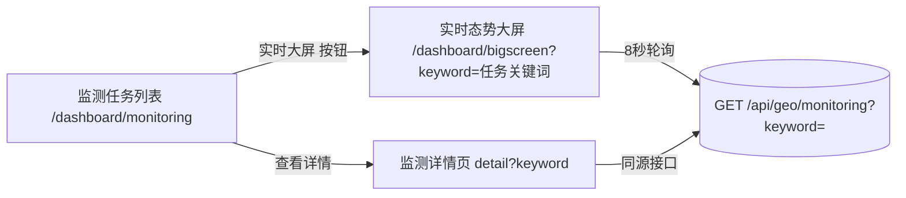

## 用户需求

在 AI 收录监测（`/dashboard/monitoring`）任务列表中，为每行增加一个「实时大屏」入口，点击后跳转到实时态势大屏（`/dashboard/bigscreen`）并展示该监测任务关键词对应的实时态势，实现监测任务与大屏的可视化联动。

## 产品概述

当前实时大屏默认写死关键词「域途GEO」展示泛化态势，与监测任务列表割裂。本次改造让大屏支持从任务列表带入关键词，使「任务管理 → 实时可视化」形成闭环：用户在任务列表点击某个任务的「实时大屏」即可看到该任务专属的实时作战大屏。

## 核心功能

- 任务列表操作列新增「实时大屏」按钮（与已有的「查看详情」「删除」并列）
- 点击「实时大屏」携带任务关键词/平台跳转至大屏页
- 大屏页支持从 URL 参数 `keyword` 读取初始监测关键词，无参数时回退默认「域途GEO」
- 大屏顶部回显当前所展示监测任务的标识，明确联动来源
- 侧边栏直接进大屏、无参数访问时行为不变

## 技术栈

- 前端框架：Next.js App Router + TypeScript + React 19
- UI 组件库：shadcn/ui (Radix UI) + Tailwind CSS
- 图标：Lucide React
- 图表：Recharts（大屏已用，无需新增）

## 实现方案

### 总体策略

两个页面均为 App Router 客户端组件，无需改动后端（`GET /api/geo/monitoring?keyword=` 已存在）。核心改动极小：大屏增加 `useSearchParams` 读取初始 keyword；任务列表增加跳转按钮复用既有 `router.push` 模式。

### 关键决策与理由

1. **大屏初始 keyword 从 URL 参数读取**：大屏的 `load(kw)` 和 useEffect 已完全由 `keyword` 状态驱动（依赖 `[keyword]`），仅需把 `useState` 初值改为 `searchParams.get("keyword") || "域途GEO"` 即可联动，零侵入、零新依赖。
2. **任务列表复用 `openDetail` 跳转模式**：列表页已有 `router.push('/dashboard/monitoring/detail?keyword=...&platforms=...&competitors=...')`，新增 `openBigscreen(t)` 同理 `router.push('/dashboard/bigscreen?keyword=...&platforms=...')`，保持代码一致性，避免引入新范式。
3. **大屏顶部加「当前监测任务」回显**：通过接收 `keyword` 参数时显示任务标识条，让用户明确大屏当前展示的是哪个任务，避免"疑似默认数据"的困惑；无参数时不显示该条，保持原行为。

### 性能与可靠性

- 跳转为纯前端路由（`router.push`），无新增网络请求；大屏仍保持 8 秒轮询同一接口，性能持平。
- 竞态处理：大屏 `load` 已用 `setRefreshing` 包裹，参数切换时 useEffect 重订阅，无重复定时器泄漏（原 cleanup 已清理 interval）。
- 向后兼容：大屏无参访问（侧边栏点入）行为完全不变；任务列表「查看详情」「删除」不受影响。

## 实现注意事项

- 大屏页当前未导入 `useSearchParams`，需从 `next/navigation` 补充导入，与任务列表页导入方式一致。
- 大屏顶部已有 `BRANDS` 写死品牌切换按钮（域途GEO/SEO大师/AI优化王），联动参数 keyword 可能与这三个不一致（任务关键词任意），此时品牌切换按钮高亮态应与 URL 参数解耦，仅作为快捷切换入口，不影响 `keyword` 状态初始化。
- 提交到 yutu-geo 本地仓库（沿用项目既有 git 工作流）。

## 架构设计



## 目录结构

```
src/app/dashboard/
├── monitoring/
│   └── page.tsx              # [MODIFY] 任务列表页。操作列新增「实时大屏」按钮，复用 router.push 跳转 /dashboard/bigscreen?keyword=&platforms=；新增 openBigscreen(t) 函数
└── bigscreen/
    └── page.tsx              # [MODIFY] 实时大屏页。导入 useSearchParams；初始 keyword 改为 searchParams.get('keyword') || '域途GEO'；顶部增加当前监测任务回显条（仅当有参数时）
```