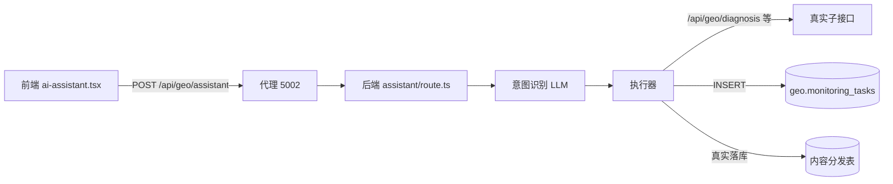

## 用户需求

用户反馈域途 AI 助手"还是用不了"，要求站在专业角度检查并给出改造计划，使其在 yutu-geo 项目中"好用、能用、可靠"。

## 产品概述

域途 AI 助手是 yutu-geo 前端内的嵌入式对话组件（悬浮球 + 可拖拽面板），通过"说一句话就能执行"的行动型交互，调用后端各类 GEO 能力（诊断、文案、关键词、工具箱、外链、监测、建站、分发、知识问答）。本计划修复使其真正可用的阻塞性问题，并提升可靠性与可观测性。

## 核心问题（已核查确认）

1. 入口路径错配（致命）：前端 `POST /api/assistant` 经代理转发到后端 `/api/assistant`，但后端真实路由在 `/api/geo/assistant`，导致整个助手 404 不可用。
2. 内部子接口全部 404（致命）：后端 assistant 路由内 `executeDiagnosis/executeCopywriting/executeKeywords/executeToolkit/executeBacklinks/executeAutoSite` 调用的 baseUrl 默认 `http://localhost:5000`，且子路径为 `/api/diagnosis` 等裸路径；后端实际监听 5002，真实路由在 `/api/geo/*` 下，所有动作型能力全部失败。
3. 内容分发为假数据（不可靠）：`/api/geo/content-distribute` 使用 `simulateDistribution`，随机成功、返回 example.com 假 URL、内存存储不落库。
4. 错误提示缺乏针对性：前端 catch 仅提示"服务端无法连接"，无法区分路径错误/超时/业务失败。
5. 路径与平台小不一致：后端监测跳转 `/dashboard/monitor` 与前端 ROUTE_MAP 的 `/dashboard/monitoring` 不一致；监测平台写死 9 个，与前端 `ALL_PLATFORMS` 列表数量不一致。

## 核心特性（改造目标）

- 修复前后端路径与端口，使助手所有意图真实可达后端。
- 内容分发真实落库并反馈真实状态，不再返回假 URL。
- 前端具备针对性错误诊断（路径/网络/业务失败分类提示）与健康检查。
- 统一监测平台集合与跳转路径，保证前后端一致。
- 保留并强化知识问答真实 LLM 能力。

## 技术栈

- 前端：Next.js 16（App Router）+ React 19 + TypeScript，yutu-geo 项目
- 后端：Next.js 16（App Router）+ TypeScript + node-postgres，lakeli-app-xc 项目
- 通信：前端 `next.config.ts` rewrites 将 `/api/:path*` 代理到 `NEXT_PUBLIC_API_URL`（默认 `http://localhost:5002`）

## 实现方案

### 总体策略

分三层修复：① 入口路由对齐（前端改调 `/api/geo/assistant` 或后端加 `/api/assistant` 别名，二选一、最小改动为前端改路径）；② 后端 assistant 内部子接口统一改为 `geo.*` 前缀且 baseUrl 从运行环境变量读取（与 dev 端口 5002 对齐）；③ 内容分发去假化落库。辅以前端错误分类提示与路径一致性修复。

### 关键技术决策

- **入口对齐采用"前端改调 `/api/geo/assistant`"**：前端仅一处 fetch 改动，零后端结构变更，风险最低；优于新增后端别名路由（需改 middleware 鉴权）。
- **后端 baseUrl 统一**：`process.env.DEPLOY_RUN_PORT || process.env.PORT || 5002`，并默认指向 5002，避免再写死 5000。所有子接口路径改为 `/api/geo/<xxx>`，与已确认的真实路由一致。
- **内容分发去假化**：保留 LLM 平台风格优化，将任务写入 `geo.content_distribution_tasks`（如不存在则用现有 `dbSaveDistribution`，改为真实落库）；分发结果不造假 URL，仅反馈真实状态。
- **错误分类**：前端根据 fetch 失败类型（网络错误 / HTTP 非 2xx / 超时）给出不同提示，并加一个"检查后端"按钮；保留 ROUTE_MAP 跳转兜底。

### 性能与可靠性

- 后端子接口调用加超时控制（AbortController，10s），避免助手卡死。
- 知识问答 LLM 失败回落标注"（离线参考）"，不掩盖故障（已落地，保留）。
- 所有真实动作保持非阻塞写任务记录（persistBestEffort 已落地）。

## 实现注意事项

- 改动严格限定在 assistant 链路，不触碰无关页面。
- 子接口路径以 search 确认的真实路由为准：`/api/geo/diagnosis`、`/api/geo/copywriting`、`/api/geo/keywords`、`/api/geo/toolkit`、`/api/geo/backlinks`、`/api/geo/auto-site`、`/api/geo/content-distribute`。
- 监测平台集合提炼为共享常量（与前端 `ALL_PLATFORMS` id 对齐）。
- 改动后两仓库分别提交（遵循本地提交规则）。

## 架构设计

前端组件 → 代理 `/api/geo/*` → 后端 `assistant/route.ts` → 意图识别(LLM) → 执行器 → 真实子接口(`/api/geo/*`) / 真实写库(`geo.monitoring_tasks`、内容分发表)。



## 目录结构

```
lakeli-app-xc/src/app/api/geo/assistant/route.ts   # [MODIFY] 修正 baseUrl(5002) 与全部子接口为 /api/geo/*；监测平台常量化
lakeli-app-xc/src/app/api/geo/content-distribute/route.ts  # [MODIFY] 去除 simulateDistribution 假数据，改为真实落库与状态反馈
yutu-geo/src/components/ai-assistant.tsx            # [MODIFY] 改调 /api/geo/assistant；错误分类提示；跳转路径对齐
yutu-geo/next.config.ts                             # [不用改，已正确代理 /api/*]
```

## 关键代码结构（修正点示例）

```ts
// assistant/route.ts 统一 baseUrl
const INTERNAL_BASE = `http://localhost:${process.env.DEPLOY_RUN_PORT || process.env.PORT || 5002}`;
// 子接口调用示例
await fetch(`${INTERNAL_BASE}/api/geo/diagnosis`, {...});
```

## Agent Extensions

### SubAgent

- **code-explorer**
- Purpose: 在执行前再次精确核验lakeli-app-xc 内所有被 assistant 调用的子接口真实路径与 content-distribute 落库函数签名，避免路径/参数错配
- Expected outcome: 输出各子接口确切路径、入参结构、dbSaveDistribution 等落库函数签名，确保计划落地精确