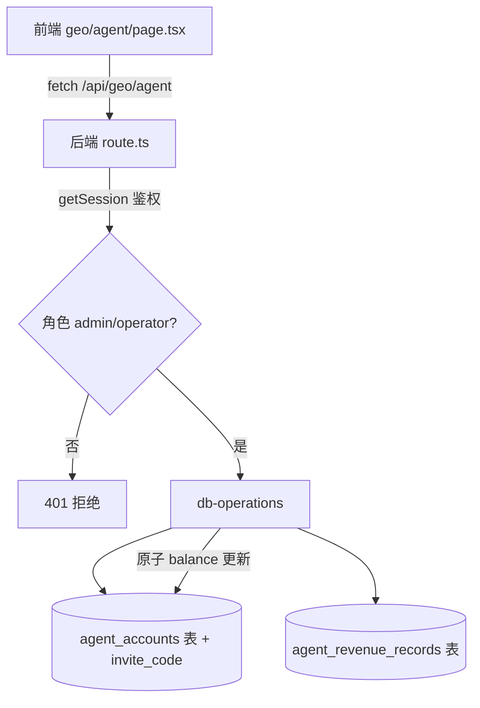

## 用户需求

审核域途 GEO「代理商后台」（`/geo/agent`）这一 agent 模块的设计可靠性，并修复发现的设计缺陷。

## 产品概述

「代理商后台」是域途 GEO SaaS 插件内的代理商户管理界面，面向运营/超管，提供代理子账号开通、额度分配、佣金计算、收益看板能力。涉及前端页面（`lakeli-admin-web/src/app/(dashboard)/geo/agent/page.tsx`）与后端接口（`lakeli-app-xc/src/app/api/geo/agent/route.ts` + 数据层 + 表结构）。

## 核心问题（设计层审查结论）

经代码核实，该 agent 并非"好用、可靠"，存在以下设计缺陷，按严重程度排序：

1. **前后端数据结构完全脱节（致命）**：后端返回 `{code,data[]}`，前端却读取 `data.success`/`data.accounts`/`data.invite_code`/`data.commission_rate`/`data.balance`/`data.total_revenue`，字段全部对不上，页面实际永远渲染空列表、概览全 0、创建后弹失败提示。
2. **后端接口零鉴权、零权限隔离**：GET/POST/PUT 均无会话校验；`user_id` 由请求体伪造；任意匿名可调佣金额度、任意正负调余额。
3. **余额调整无事务一致性**：读-改-写两步非事务，并发丢更新；流水写入与余额变更非原子，账本与余额可能不一致。
4. **invite_code 未生成未返回**：前端成功弹窗依赖邀请码，但表结构与后端均未实现。
5. **边界校验缺失**：佣金比例可负数/超 1；余额任意正负无语义约束、无审计留痕。
6. **等保三级一致性缺口**：与 `docs/等保三级-域途GEO SaaS合规设计.md` 的鉴权/审计要求不符。

## 修复目标

- 对齐前后端数据结构，使代理商后台真实可用。
- 后端补齐鉴权、权限隔离、事务一致性、邀请码、边界校验与操作审计。
- 不扩大改动面，仅修复 `geo/agent` 链路，保持与现有 `admin-api`/RBAC 模式一致。

## 技术栈

- 前端：Next.js 16 (App Router) + React 19 + TypeScript 5 + Tailwind CSS v4 + shadcn/ui
- 后端：Next.js 16 API Routes + TypeScript 5 + Supabase（PostgreSQL）+ Drizzle ORM schema 定义
- 鉴权：复用现有 `getSession`（参考其他 `api/geo/*` 与 `api/admin/*` 路由的鉴权写法）

## 实施方法

采用"先对齐契约、再补后端能力、最后修前端消费"的顺序修复，确保改动闭环且可回归。所有修改遵循现有项目约定（返回 `{code,data}` 风格、Drizzle schema 定义、RBAC 矩阵）。

### 关键技术决策

1. **数据契约对齐**：统一为后端 `{code:0,data:{accounts:[...],inviteCode, commissionRate, balance, totalRevenue, revenueTrend}}`；前端改为读 `data.accounts` 等。前端不再依赖不存在的 `success` 字段，改用 `code===0` 判定。
2. **鉴权复用现有模式**：后端 `route.ts` 增加 `getSession()` 校验；仅 `admin`/`operator` 可访问（与 sidebar `ROLE_ACCESS['geo-agent']` 一致）。`user_id` 不再由前端传入，改为从 session 取。
3. **事务一致性**：Supabase 侧改用 `rpc` 或 `select`+`update` 合并为单条带计算的 update（`balance = balance + amount`），并写入收支流水同事务（或顺序且可回滚）。推荐 `dbAdjustAgentBalance` 改用 `update` 的原子表达式 `balance: sql\`balance + ${amount}\``。
4. **邀请码**：`agentAccounts` 表加 `invite_code` 列（唯一索引）；`dbCreateAgentAccount` 生成码（如 `AGT-` + base36(uuid 前 8 位)）；返回携带。
5. **边界校验**：佣金比例约束 `[0,1]`；余额调整 `amount` 非零且不允许余额变负（除非类型允许）；PUT 操作写审计日志（复用 operation-log 现有机制或 `agent_revenue_records.description` 标注操作人）。

## 实施注意事项

- 后端改动需在 `lakeli-app-xc` 仓库提交；前端在 `lakeli-admin-web` 仓库提交（均按工作区规则 `git add -A && git commit`）。
- 不触碰 `geo/agency`（客户 BVI 看板），不在本次范围。
- 避免引入新依赖；事务/原子更新优先用 Supabase 原生能力。
- 改动后前端 `ts-check` 通过；后端复用既有 `getSession` 不新增鉴权抽象。

## 架构设计



修改集中于 B（鉴权+契约）、D（事务+邀请码+校验）、E（加列）、A（消费修正），不改动其他模块。

## 目录结构

```
lakeli-app-xc/                                  # [后端仓库]
├── src/app/api/geo/agent/route.ts              # [MODIFY] 增加 getSession 鉴权与角色校验；对齐返回结构 {code,data:{accounts,inviteCode,commissionRate,balance,totalRevenue,revenueTrend}}；PUT 增加边界校验与审计
├── src/storage/database/db-operations.ts       # [MODIFY] dbCreateAgentAccount 生成 invite_code；dbAdjustAgentBalance 改为原子 update(balance+amount)；dbAddAgentRevenueRecord 标注操作人
└── src/storage/database/schema.ts              # [MODIFY] agentAccounts 增加 invite_code 列（唯一索引），配套 drizzle migration

lakeli-admin-web/                               # [前端仓库]
└── src/app/(dashboard)/geo/agent/page.tsx      # [MODIFY] 修正 fetch 解析：用 code===0 判定成功；读取 data.accounts/data.inviteCode/data.commissionRate/data.balance/data.totalRevenue；创建成功读 inviteCode
```

## 关键代码结构（后端契约）

```ts
// GET /api/geo/agent?action=overview
// 返回：{ code: 0, data: { accounts: AgentVO[], inviteCode: string, commissionRate: number, balance: number, totalRevenue: number, revenueTrend: {day:string,amount:number}[] } }
// AgentVO: { id, company, phone, email, level, commissionRate, balance, status, createdAt }

// POST /api/geo/agent  body: { company, phone, email, level, commissionRate }
// 返回：{ code: 0, data: { ...AgentVO, inviteCode: string } }
```