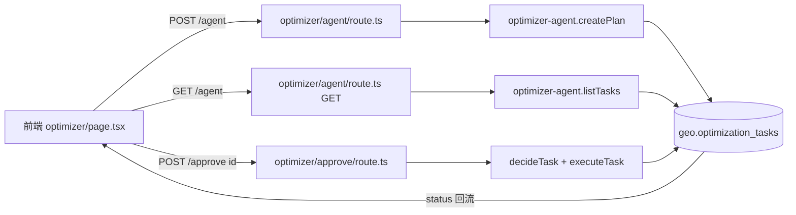

## 用户需求

将域途优化 Agent 从「半成品」改造为真正可运行的执行闭环：生成优化计划 → 任务进入审批队列（pending_approval）→ 人工审批 → 审批通过后立即执行并落库（done），前端时间线真实反映每个任务的审批/执行状态。

## 产品概览

域途 GEO 系统的「域途优化 Agent」页面当前只能生成一份前端本地状态机时间线，"一键下发"仅把数据插入数据库便结束，用户永远无法审批、执行也无真实落库。需复用后端已存在但前端未接入的 Agent 运行时（optimizer-agent.ts）与两个接口，让闭环真实可用。

## 核心特性

- 生成计划：调用 `/api/geo/optimizer/agent` 将优化动作写入 `geo.optimization_tasks` 表（状态 pending_approval），前端时间线由真实队列（GET `/api/geo/optimizer/agent`）驱动。
- 人工审批：时间线每个待审任务提供「通过 / 驳回」按钮，调用 `/api/geo/optimizer/approve` 真实更新库内状态（approved/rejected）。
- 执行落库：审批通过后后端 `executeTask` 将任务置为 done 并写入 executed_at 与占位 result；前端明确标注「已记录执行（占位，真实内容分发待接入）」，不谎称产出内容。
- 状态可视：时间线如实展示 pending_approval / approved / executing / done / rejected 各态与用时。
- 移除误导：删除原前端"一键下发"中"预计 N 分钟完成首轮执行"的虚假文案与手写 dispatch 调用；保留 forecast / profile / audit 面板。

## 技术栈

- 前端：Next.js（App Router）+ React + TypeScript + Tailwind（yutu-geo 项目）
- 后端：Next.js Route Handler + TypeScript + PostgreSQL（pg 连接池，lakeli-app-xc 项目）
- 既有能力复用：`optimizer-agent.ts`（createPlan/decideTask/executeTask/listTasks）、`/api/geo/optimizer/agent`、`/api/geo/optimizer/approve`
- 代理：yutu-geo `next.config.ts` rewrites 已将 `/api/*` 转发至 `lakeli-app-xc:5002`

## 实现方案

### 策略

不新增接口与依赖，前端改为消费后端已就绪的 Agent 运行时：生成走 `POST /api/geo/optimizer/agent`，队列走 `GET /api/geo/optimizer/agent`，审批走 `POST /api/geo/optimizer/approve`。前端时间线数据源从"本地硬编码 6 阶段状态机"切换为"真实任务队列"，实现监测异常 → 计划入队 → 审批门控 → 执行落库的完整闭环。

### 关键技术决策

- **复用而非重写**：后端 `optimizer-agent.ts` 与两个路由已完整实现 decide/execute/list 且含审计（`writeAudit`，controlItem=F6），前端直接对接可零新增后端代码、避免双写同一张表。
- **清理双写入口**：后端 `route.ts` 的 `dispatch` action（手写 INSERT，与 `createPlan` 重复且永不更新状态）标记为 deprecated/移除，前端不再调用，消除两套入口写 `optimization_tasks` 的混乱。
- **执行语义诚实**：`executeTask` 当前仅写占位 result，前端在时间线 done 态明确标注「已记录执行（占位）」，不伪装成已发布内容，符合合规要求。
- **状态机修复**：原本地状态机硬编码 stage[0]=done、其余=pending、无 active 态，导致审批按钮永不渲染。改为以队列真实 status 驱动渲染，待审任务才显示按钮。

### 性能与可靠性

- 生成/审批均为单次参数化查询，O(1)；队列查询为 `ORDER BY created_at DESC` 加索引，数据量小无瓶颈。
- 后端接口已对查库失败返回 503（区分空队列与失败），前端需兼容 `{success:false, code:'DB_ERROR'}` 给出提示而非白屏。
- 代理链路已是现成配置，无需改动。

## 实现注意事项

- 保持 `forecast / profile / audit` 三个 action 不动，它们对接 `/api/geo/optimizer` 仍可用。
- 移除 `dispatchPlan` 或将其改造为「刷新审批队列」按钮，禁止再出现"预计 N 分钟完成执行"类文案。
- `generate()` 入参补充 `metrics`（可由 profile / 监测历史推导，无则空对象 `{}`），让 `proposeActions` 规则生效；不再需要手动传 competitors（后端按 keyword 从 `monitoring_tasks` 取）。
- 改动后分别执行 `pnpm ts-check`（前端）、`pnpm tsc --noEmit`（后端）与 lint，通过后再各自提交。

## 架构设计



## 目录结构

```
yutu-geo/src/app/dashboard/optimizer/
└── page.tsx              # [MODIFY] 唯一需改前端文件。generate 改调 /agent；时间线改由 GET /agent 队列驱动；审批按钮调 /approve；移除 dispatchPlan 虚假文案；done 态标注占位执行说明。

lakeli-app-xc/src/app/api/geo/optimizer/
└── route.ts              # [MODIFY] 将 dispatch action 标记 deprecated 或直接移除（前端不再调用），保留 generate/forecast/profile/audit，避免与 optimizer-agent 双写 optimization_tasks。

（以下文件无需改动，仅作依赖说明）
lakeli-app-xc/src/lib/geo/optimizer-agent.ts        # 已存在：createPlan/decideTask/executeTask/listTasks
lakeli-app-xc/src/app/api/geo/optimizer/agent/route.ts   # 已存在：生成+查队列
lakeli-app-xc/src/app/api/geo/optimizer/approve/route.ts # 已存在：审批即执行
```

## Agent Extensions

### SubAgent

- **code-explorer**
- 用途：在落地阶段若需进一步确认 `optimizer-agent.ts` 返回结构、后端审批路由字段或 yutu-geo 其它页面是否引用 dispatch，可用其跨文件检索。
- 预期结果：精确定位所有需要同步调整的调用点与类型定义，避免遗漏。