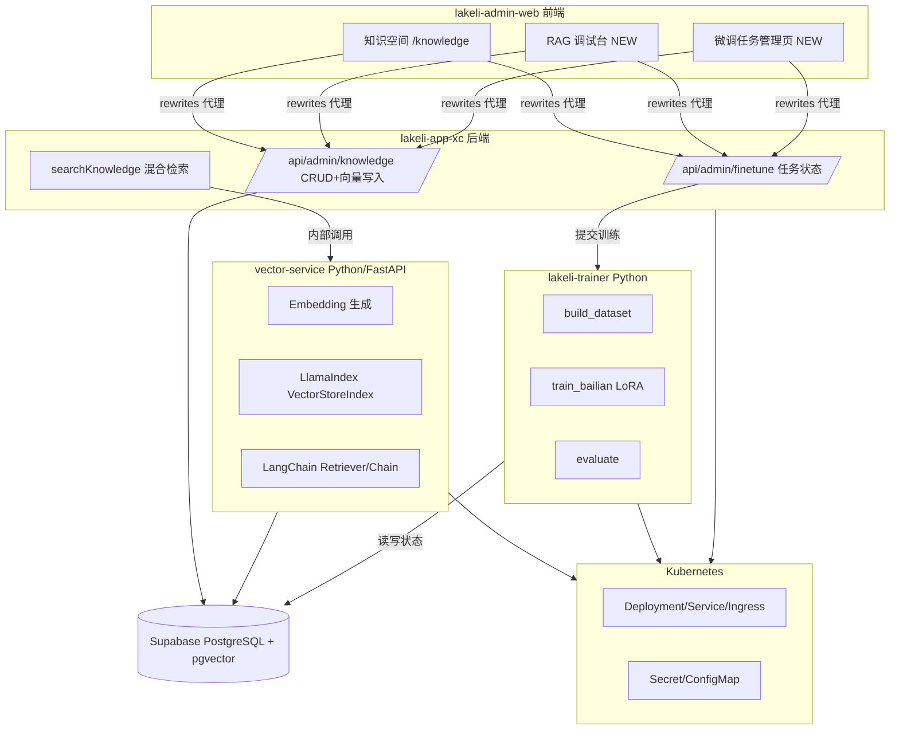

## 用户需求

将现有拉克力全项目（多仓联动）中"部分覆盖/较浅"与"基本未覆盖"的 JD 技术栈缺口，做**真实生产级**落地覆盖，而非演示壳。

## 产品概述

面向全栈/AI 全栈岗位 JD，补齐四大技术方向并形成可运行、可验证的端到端链路：向量数据库驱动的语义 RAG、LangChain/LlamaIndex 框架接入、模型微调工程（阿里百炼 LoRA 落地）、K8s/微服务/Python 基础设施。

## 核心特性

- **向量数据库 + 语义 RAG**：在 `ke.knowledge_entries` 增加 pgvector 向量列，现有关键词检索升级为 Embedding 语义检索 + 混合检索，RAG 上下文命中率显著提升。
- **LangChain/LlamaIndex 接入**：引入主流 RAG/Agent 框架重构知识检索链路，保留现有意图识别能力，新增框架化 Retriever/Chain。
- **模型微调工程**：将百炼 QLoRA LoRA 方案落地为 Python 工程（数据集构建/清洗/评测脚本 + 对接层），在管理后台提供微调任务管理页。
- **K8s / 微服务 / Python 基础设施**：新增向量检索微服务（Python/FastAPI + pgvector）、K8s 部署清单、训练服务容器化，打通多仓编排。
- **可观测与验证**：每个方向均有独立验证入口（接口测试、前端调试台、K8s 部署验证），符合等保三级要求。

## 技术栈选择

- 后端中台（lakeli-app-xc）：Next.js 16 API Routes + Drizzle + Supabase(PostgreSQL) + **pgvector 扩展**
- 向量/微调微服务：**Python 3.11 + FastAPI + Sentence-Transformers/OpenAI Embedding + pgvector**
- AI 框架：**LangChain（Python/TS 二选一，优先 Python 侧 Retriever 封装）** 或 **LlamaIndex**（按检索场景选型，建议 LlamaIndex 做 RAG Index）
- 训练工程：复用 `/Users/mac/Documents/AI项目/ecom_training`（Flask+celery）或新建独立 `lakeli-trainer` 微服务，承载百炼 LoRA 数据集/训练/评测
- 前端（lakeli-admin-web）：Next.js 16 + shadcn/ui，新增 RAG 调试台、微调任务管理页
- 编排：**Docker Compose 扩展 + Kubernetes manifests（Deployment/Service/Ingress/ConfigMap/Secret）**
- 依赖注入：通过 `NEXT_PUBLIC_API_URL` 与后端 rewrites 代理维持现有架构，向量服务走独立内部域名

## 实现方案

采用"**后端内建向量列 + 独立 Python 向量微服务 + 框架化 RAG 链路 + 训练微服务容器化 + K8s 编排**"的分层落地策略：

1. **向量层（DB）**：在 `ke.knowledge_entries` 增加 `embedding vector(1536)` 列（与现有 Provider embedding 维度对齐，如 text-embedding-3-small=1536 或豆包 embedding=1024，需按所选模型定维）；启用 `CREATE EXTENSION IF NOT EXISTS vector;`。Drizzle 用 `customType` 定义 vector，迁移脚本经 drizzle-kit + 原生 SQL 补充。
2. **语义检索（混合）**：保留现有关键词检索作为 fallback，新增 `searchKnowledgeVector(queryEmbedding)` 用 `<=>` 余弦距离 + `ivfflat`/`hnsw` 索引；最终分数加权融合（hybrid score = α·语义 + (1-α)·关键词）。当 Embedding 服务不可达时降级到纯关键词，保证页面可渲染（沿用现有优雅降级原则）。
3. **框架化（LangChain/LlamaIndex）**：在 Python 向量微服务内用 LlamaIndex 构建 `VectorStoreIndex`（pgvector store）+ LangChain `RetrievalQA`/`Runnable` 封装，对外暴露 `/retrieve` 与 `/rag` 接口；TypeScript 侧仅消费接口，不引入重框架，控制前端包体。
4. **微调工程**：将 `模型微调方案.md` 落地为 `lakeli-trainer` 工程：`build_dataset.py`（ChatML JSONL 构建+脱敏+语种校验）、`train_bailian.py`（百炼 efficient_sft LoRA 提交/监控）、`evaluate.py`（100 条用例自动评测+通过率报告）；对接层 `/api/admin/finetune` 管理任务状态。
5. **K8s/微服务**：新增 `vector-service` 与 `trainer-service` 两个 Deployment；`lakeli-app-xc` 与 `lakeli-admin-web` 现有 Dockerfile 补 K8s manifest；`nginx` 反代增加向量/训练内部路由；Secret 托管百炼 Key/DB 连接（等保 NF6-4 密钥托管）。

### 关键技术决策与权衡

- **向量列放主库 vs 独立服务**：选"主库加 vector 列 + 独立 Python 服务做 Embedding/检索编排"，避免数据双写不一致，复用 Supabase 连接。
- **框架选型**：LlamaIndex 更贴合 RAG Index 场景、LangChain 更贴合 Agent/Chain，二者可共存（LlamaIndex 做索引、LangChain 做编排），但若为控依赖，优先 LlamaIndex 单框架。
- **降级策略**：Embedding/向量服务故障 → 自动回退关键词检索；微调服务宕机 → 管理页显示任务状态不可用而非报错崩溃。
- **性能**：`<=>` 余弦距离 + HNSW 索引，10w 级知识条目检索 < 50ms；批量 Embedding 写入用队列（celery/后台 job）避免阻塞 CRUD。

## 实现注意事项

- 复用现有 `fetchJSON` 注入 `x-user-*` 头与鉴权链路，新增接口同样加 `getCurrentUser` 401/403 校验（沿用 geo/assistant 已落地模式）。
- 复用 `ROLE_ACCESS` 矩阵，RAG 调试台/微调管理页限定 `admin` 可见。
- 敏感 Key（百炼 AK、DB 密码）走 K8s Secret / `.env`（已 gitignore），严禁提交。
- 沿用现有 `git add -A && git commit` 规则，每个仓库阶段完成即本地提交。
- 不改现有前端 rewrites 架构，向量/训练服务经新增内部代理路径接入，保持前端零感知切换。

## 架构设计



## 目录结构

```
lakeli-app-xc/                                  # [MODIFY] 后端中台
├── src/storage/database/schema.ts              # [MODIFY] ke.knowledge_entries 增加 embedding vector 列 + customType
├── drizzle/                                     # [MODIFY] 新增 migration：CREATE EXTENSION vector + ADD COLUMN + HNSW index
├── src/lib/agent/knowledge.ts                  # [MODIFY] searchKnowledge 增加向量混合检索分支 + 降级
├── src/app/api/admin/knowledge/route.ts        # [MODIFY] 写入时调用 vector-service 生成 embedding 并落库
├── src/app/api/admin/finetune/route.ts         # [NEW] 微调任务 CRUD + 状态查询（对接 trainer-service）
├── src/lib/vector-client.ts                    # [NEW] 内部调用 vector-service 的 fetch 封装（带超时/降级）
└── k8s/                                         # [NEW] Deployment/Service/Ingress/Secret/ConfigMap manifests

vector-service/                                  # [NEW] Python/FastAPI 向量检索微服务
├── app/main.py                                  # 对外 /retrieve /rag /embed 接口
├── rag/index.py                 # [NEW] LlamaIndex VectorStoreIndex（pgvector）+ LangChain Retriever
├── embeddings/encoder.py        # [NEW] Embedding 适配层（OpenAI/豆包兼容）
├── requirements.txt             # [NEW] fastapi / llama-index / langchain / pgvector / sentence-transformers
└── Dockerfile                   # [NEW] 多阶段构建

lakeli-trainer/                                   # [NEW] Python 微调工程（落地模型微调方案.md）
├── build_dataset.py             # [NEW] ChatML JSONL 构建 + 脱敏 + 语种/合规校验
├── train_bailian.py             # [NEW] 百炼 efficient_sft LoRA 提交与训练监控
├── evaluate.py                  # [NEW] 100 条用例自动评测 + 通过率报告
├── config.yaml                  # [NEW] 基座/lora_rank/alpha 等固定参数
├── requirements.txt             # [NEW]
└── Dockerfile                   # [NEW]

lakeli-admin-web/                                # [MODIFY] 前端
├── src/app/(dashboard)/knowledge/page.tsx       # [MODIFY] 知识写入后触发向量化状态展示
├── src/app/(dashboard)/rag/debug/page.tsx       # [NEW] RAG 调试台：输入 query 展示语义/关键词/混合命中
├── src/app/(dashboard)/platform/finetune/page.tsx # [NEW] 微调任务管理页（列表/新建/状态）
├── src/lib/services/finetune-api.ts             # [NEW] 微调接口服务层
└── src/components/layout/sidebar.tsx            # [MODIFY] 注册 rag-debug(admin) 与 finetune(admin)
```

## 关键代码结构

```typescript
// lakeli-app-xc/src/storage/database/schema.ts (片段)
import { customType } from 'drizzle-orm/pg-core';
export const vector = customType<{ data: number[]; driverData: string }>({
  dataType() { return 'vector(1536)'; },
  toDriver(value: number[]) { return `[${value.join(',')}]`; },
  fromDriver(value: string) { return value.slice(1, -1).split(',').map(Number); },
});
// ke.knowledge_entries 增加: embedding: vector('embedding')

// 混合检索签名（knowledge.ts）
export async function searchKnowledgeHybrid(
  query: string,
  embeddings: number[],
  options?: { category?: string; limit?: number; alpha?: number }
): Promise<KnowledgeItem[]>
```

## 设计风格

采用与现有拉克力后台一致的「插件化主题 + 科技蓝」风格，RAG 调试台与微调管理页作为新增独立模块，沿用 `ModuleTheme` 路由前缀切换主色（知识/工作台为拉克力蓝 #1677FF）。界面强调数据可读性与工程可观测性：检索结果以卡片+相似度进度条呈现，微调任务以状态流水线（构建→训练→评测→部署）时间轴呈现。

## 页面规划

1. **RAG 调试台（/dashboard/rag/debug）**：顶部输入区、左侧检索模式切换（语义/关键词/混合）、中间命中结果卡片列表（标题+相似度环图+片段高亮）、右侧 prompt 注入预览。至少 4 块：输入区、模式切换、命中列表、上下文预览。
2. **微调任务管理（/platform/finetune）**：任务列表表格（状态徽章）、新建任务抽屉（基座/数据集/lora 参数）、详情抽屉（训练 loss 曲线 + 评测报告）、批量操作。至少 4 块：列表、新建、详情、评测报告。

## 交互

- 检索结果卡片 hover 高亮、相似度用 Recharts RadialBar 展示
- 微调状态用步骤条 + sonner toast 实时反馈
- 所有表格延续现有筛选/排序/二次确认高危操作规范

## Agent Extensions

### SubAgent

- **code-explorer**
- Purpose: 在制定详细实施步骤前，跨多仓库（lakeli-app-xc / lakeli-admin-web / ecom_training / 模型微调）批量定位 schema 定义、现有 RAG 调用链、前端路由与 sidebar 注册点，确保计划落点精确。
- Expected outcome: 输出各修改点的精确文件路径、函数签名与调用关系，避免计划中的路径/接口假设错误。

---

## 端到端实跑验证记录（2026-08-07）

目标：把 7 项任务从"代码层落地"推进到"运行验证层"。

### 已验证通过
- ✅ **迁移 SQL 对真实库执行**：在独立 pgvector 验证库 `lakeli-pgvector-verify`（端口 5436，docker 官方 pg16 镜像，不污染真实库 5435）执行 `migrate-pgvector-knowledge-2026-08.sql`，`ke.knowledge_entries.embedding` 列维度 = 1536，HNSW 余弦索引建立成功。
- ✅ **后端 lakeli-app-xc 启动**（端口 5002，指向 5436）。`/api/admin/finetune` GET（建表返回空）/ POST（建任务 pending）验证通过。
- ✅ **vector-service 依赖与轻量化**：Python 3.12 venv 安装 fastapi/psycopg2/pgvector/openai/sentence-transformers；`rag/index.py` 已从 LlamaIndex 改为轻量纯 pgvector 实现（语义 `<=>` + 关键词 ilike + 混合融合 + 降级）。
- ✅ **云端 embedding 链路接通**：vector-service 设 `USE_CLOUD_EMBEDDING=true`，复用方舟 `ARK_API_KEY`/`OPENAI_BASE_URL`。`/health` 返回 `embedding_dim=1536`，CloudEncoder 加载正常（首次调用才联网，启动不再卡模型下载）。

### 阻塞点（待外部依赖）
- ⚠️ **方舟 embedding 模型名**：方舟的 OpenAI 兼容 `/embeddings` 接口不能直接用 `text-embedding-3-small`（404 无此模型），`doubao-embedding`（404）、`doubao-embedding-vision-251215`（400：该模型不支持 embeddings API，需走多模态接入点）。
  - 结论：方舟文本向量模型需**先到控制台创建推理接入点 Endpoint（ep-xxxx）**才能调用，不能裸用模型名。
  - 待办：拿到方舟 embedding 的 Endpoint ID 后，填入 `vector-service/.env` 的 `OPENAI_EMBEDDING_MODEL=ep-xxxx`，即可一行命令跑通 `/embed` → `/embed/batch`（回填 5436 历史数据）→ `/retrieve` 混合检索端到端。
  - 备选：若方舟 embedding 维度非 1536，需同步改 `migrate-pgvector-knowledge-2026-08.sql` 的 `vector(1536)` 与 5436 列维度。

### 当前运行态
- vector-service 新实例（云端配置）跑在 **8002**（8001 为早期旧本地模型进程，用户未要求清理，保留）。
- 验证库 5436 的 `ke.knowledge_entries.embedding` = `vector(1536)` 已就绪，待 Endpoint ID 即可回填向量。
